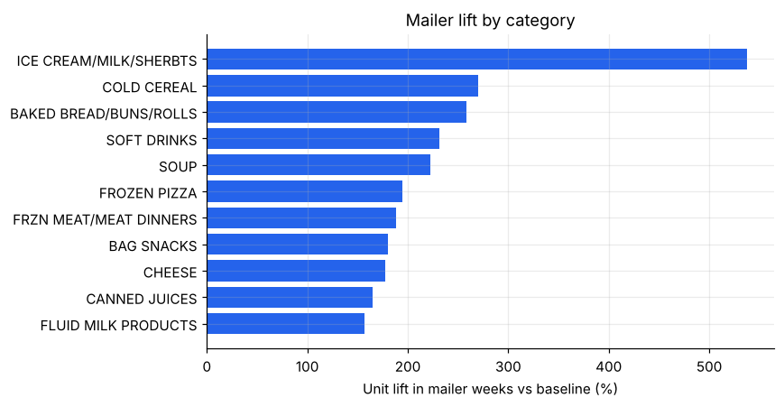
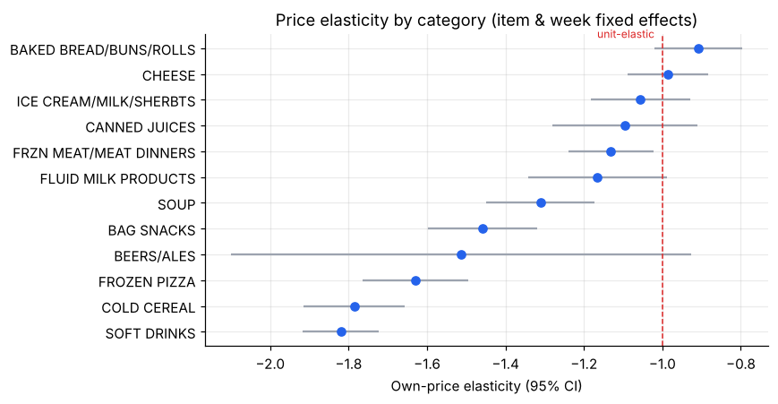
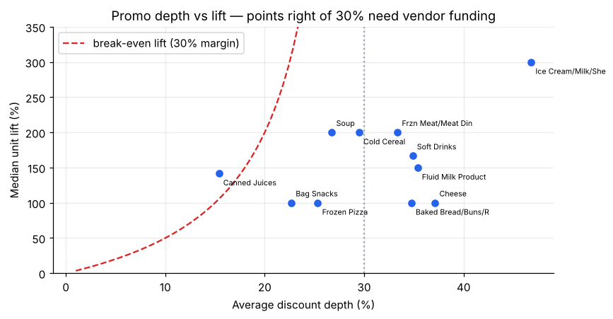
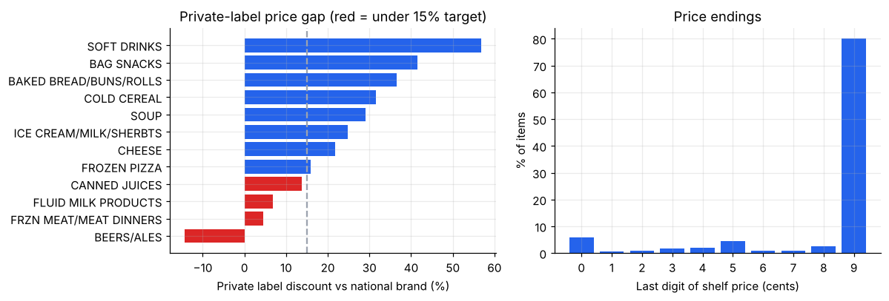

# Grocery Promotion Post-Event Analysis & Price Audit

A center-store pricing & promo review on dunnhumby's **The Complete Journey** data
(1.47M transactions, 801 households, 53 weeks, 20.9M product × store × week promotion records).
Scope: the 12 highest-revenue GROCERY categories (1,804 items, 2,709 weekly-mailer events).

## Questions answered
1. How many **incremental** units does a mailer feature really sell?
2. How much is **pulled forward** from next week or **cannibalized** from sister items?
3. How **price-elastic** is each category, and which promos should we **keep, change or drop**?
4. Is the **price architecture** healthy (private-label gap, price endings)?

## Key findings

| Finding | Result |
|---|---|
| Unit lift in mailer weeks vs. baseline | **+213%** overall (median by category from +100% to +300%) |
| Pull-forward (dip the week after) | **≈10%** of incremental units |
| Cannibalization of non-promoted sister items | **−0.6%**, not significant (p = 0.51) |
| Own-price elasticity by category | **−0.91** (bread) to **−1.82** (soft drinks) |
| Promo scorecard (30% margin assumption) | 1 KEEP · 4 DROP/rethink · 6 need vendor funding or a shallower discount |
| Median private-label discount vs national brand | **27%**; 11 of 93 product types have private label priced *above* national brand |
| Price endings | **80%** of shelf prices end in 9 |

**Recommendation:** gross lift overstates incremental volume by roughly a tenth (pull-forward), but sister-item
cannibalization is negligible. Six categories are discounted 33–47% — deeper than a typical 30% center-store
margin — so they only make sense with vendor trade funding; renegotiate funding or move to ~20–25% depth.
Soup, cereal, frozen pizza and bag snacks don't reach break-even lift at their current depth. Fix the 11
inverted private-label price points first to protect the value ladder.

| | |
|---|---|
|  |  |
|  |  |

## Method
* **Panel:** item × week units, paid price (`sales_value / quantity`) and shelf price (`(sales_value + retail_disc) / quantity`).
  Item counts as *on mailer* / *on display* when ≥50% of stores carry it that week.
* **Baseline:** rolling 13-week median of the item's non-promoted weeks. **Pull-forward:** shortfall vs baseline in the week after a mailer week.
* **Cannibalization:** item fixed-effects regression of non-promoted items' units on "a sister item is on the mailer this week".
* **Elasticity:** `log(units) ~ log(paid price) + mailer + display + item FE + week FE`, per category.
* **Scorecard:** break-even lift = d / (m − d) for discount depth d and assumed margin m = 30%.

## Files
| File | Purpose |
|---|---|
| `promo_pricing_analysis.ipynb` | Full analysis with outputs |
| `promo_pricing_analysis.py` | Same as a plain script (jupytext) |
| `charts/` | Exported figures |

## How to run
`pip install -r requirements.txt` then `jupyter nbconvert --to notebook --execute promo_pricing_analysis.ipynb`.
Data loads automatically from the `completejourney_py` package.

## Limitations
The data is an 801-household panel, not total store sales, so item-week volumes are small and noisy.
Product cost and vendor funding are not in the data (30% margin assumed). Mailer/display flags are aggregated from store-level records.

**Tools:** Python (pandas, DuckDB SQL, statsmodels), Jupyter
